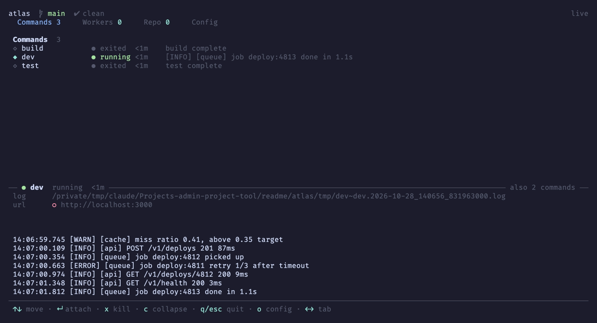
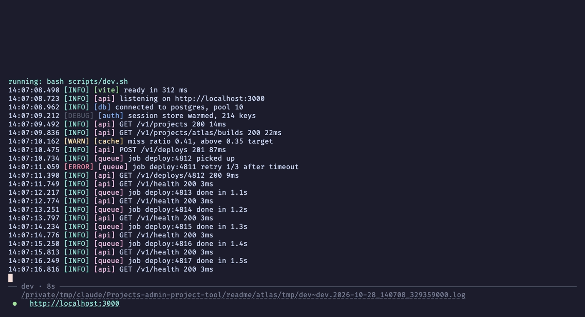
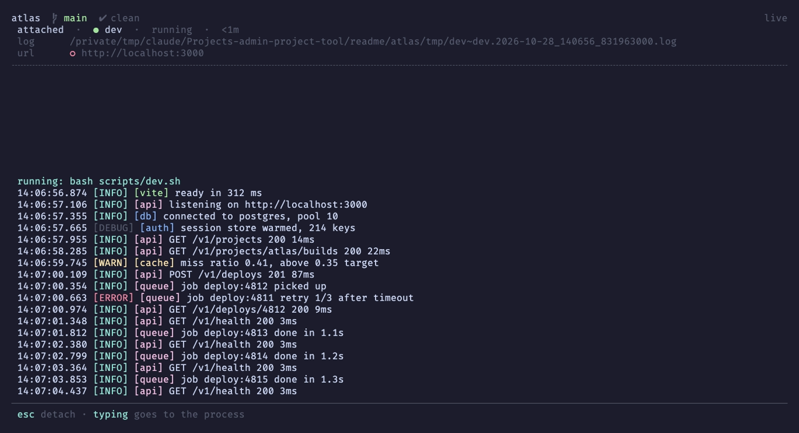

# admin-project-tool

`admin` is a task runner and terminal dashboard driven by one short file per project. A project describes its commands in `admin.toml`; the `admin` binary on your PATH finds that file by walking up from the current directory and interprets it at runtime. Nothing is generated, so editing `admin.toml` takes effect on the next run.



## Why

Every project grows its own pile of `Makefile` targets, `package.json` scripts and shell scripts, each with its own way to start a dev server, find its logs, and clean up the processes it left behind. `admin` gives every project the same front door:

- **One manifest.** `admin.toml` lists commands and the actions they run. Archetypes (`go-cli`, `apple`, `react-native`, `cloudflare-workers`, `docker`, `hugo`, `rust-tauri` and more) supply the usual commands for a stack, and the manifest overrides any of them.
- **A dashboard.** Run `admin` with no arguments for a terminal UI showing the project's commands, live workers, branches and worktrees, pull requests, issues and config, with every running command's output one keypress away.
- **Logs you can find later.** Every run writes a timestamped log file. A long-running command keeps a footer pinned to the bottom of the terminal with the log path and the URLs it serves, so they never scroll away.
- **Processes that die with their owner.** Everything a command starts is tagged and swept when `admin` exits, however it exits.
- **Guards.** A command can require a clean tree, pushed commits or any shell check before it runs.

## Installation

Requires Go 1.26 or newer.

```bash
git clone https://github.com/McBrideMusings/admin-project-tool.git
cd admin-project-tool
./install.sh
```

`install.sh` builds the `admin` binary into `~/.admin/admin`, copies the archetypes to `~/.admin/archetypes/`, and adds `~/.admin` to your PATH. The binary needs nothing else installed to run.

| Flag | Description |
|------|-------------|
| `--link` | Symlink the archetypes instead of copying them, so archetype edits are live |
| `--force` | Reinstall even when already up to date |
| `--shell zsh\|bash\|sh` | Override shell detection for rc-file PATH setup |

To update, pull and run `./install.sh` again. `./uninstall.sh` removes everything `install.sh` wrote to `~/.admin/` and the PATH line it added.

## Quick start

```bash
cd your-project
admin new        # detect the stack and write a starter admin.toml
admin check      # validate it
admin            # open the dashboard
admin dev        # or run one command straight from the shell
```

A manifest names its archetypes, its commands, and the actions each command runs:

```toml
project_name = "atlas"
archetypes   = ["go-cli"]          # brings build, test, vet, fmt, clean ...

[status.local]
kind = "http"
url  = "http://localhost:3000"

[commands.dev]
desc  = "Run the dev server"
steps = ["dev"]

[commands.deploy]
desc  = "Test, then ship"
steps = ["test", "deploy"]         # "test" comes from the go-cli archetype

[actions.dev]
kind = "shell"
run  = "go run ./cmd/server"
urls = ["local"]                   # pinned in the footer while dev runs

[actions.deploy]
kind     = "shell"
run      = "fly deploy"
requires = ["git-clean", "git-pushed"]
```

A `[commands.*]` table only routes: a description and a list of steps. What runs lives in `[actions.*]`, whose `kind` picks the behavior (`shell`, `multi-target`, `vite-dev`, `docker-dev`, `workflow`, `lua` and others). Secrets stay out of the manifest: `admin` loads the project's `.env` before resolving it, so a `run` string can say `${API_TOKEN}`.

## Running a command

From a shell, `admin dev` runs inline. Output scrolls above a footer that holds the elapsed time, the log file and the command's URLs, each a clickable link:



In the dashboard, Enter on a command starts it, and Enter on a running one attaches to its full output. Esc detaches and leaves it running:



Log lines from every source get the same `HH:MM:SS` column, severity colors, and a stable color per `[scope]` tag.

## Tool commands

| Command | Description |
|---------|-------------|
| `admin` | Open the dashboard |
| `admin <command>` | Run a command defined in `admin.toml` |
| `admin new` | Detect the project's stack and write a starter `admin.toml` |
| `admin check` | Validate that `admin.toml` parses and resolves, reporting every problem |
| `admin env` | List every environment variable the manifest references and whether it is set |
| `admin worktree <input>` | Create a worktree from a branch name, issue or PR number, or GitHub URL |
| `admin branch <input>` | Check out the same kinds of input in the current tree |
| `admin show <tab>` | Print a dashboard tab's rows as JSON |
| `admin compile` | Build a standalone `./admin` with the resolved manifest embedded, for a machine without the tool |

These names are reserved; a manifest cannot define a command with one of them.

### Running against another worktree

`-w`/`--worktree <target>` runs against a different git worktree of the current repo:

```bash
admin -w feature-x dev   # run "dev" with that worktree as the project root
admin -w feature-x       # open the dashboard on that worktree
```

`<target>` matches, in order, a directory path, a worktree's directory name, its branch name, then a case-insensitive substring of either. More than one match, or none, exits non-zero and lists the candidates. A worktree with no `admin.toml` of its own borrows the primary checkout's. See [docs/guide/worktree-target.md](docs/guide/worktree-target.md).

### The `[terminal]` launcher

A project can declare the terminal multiplexer it uses, so the dashboard opens long-running commands and agent workers in their own panes instead of hosting them itself. `[terminal]` takes shell snippets for `spawn`, `attach` and `kill`; `spawn` runs with these variables set:

| Variable | Value |
|---|---|
| `ADMIN_CMD` | the command line the new pane runs |
| `ADMIN_LABEL` | the action's label |
| `ADMIN_CWD` | the directory the pane starts in |
| `ADMIN_GROUP` | workflow dispatch only: one id shared by every target of a dispatch |
| `ADMIN_INDEX` | workflow dispatch only: the target's position in the dispatch, from 0 |

## Documentation

- [docs/architecture/design.md](docs/architecture/design.md) — how the manifest, archetypes and interpreter fit together
- [docs/architecture/lua-host-api.md](docs/architecture/lua-host-api.md) — the API Lua action bodies run against
- [docs/adr/](docs/adr/) — the decisions behind the design
- [docs/guide/clip.md](docs/guide/clip.md) — recording a looping demo clip of a project's app

The screenshots above come from the demo project in `demo/`; `demo/readme/shoot.sh` regenerates them with [vhs](https://github.com/charmbracelet/vhs).

## Development

```bash
go run . check .   # run the interpreter from the working tree
go test ./...      # the test suite
```

## License

[MIT](LICENSE)
